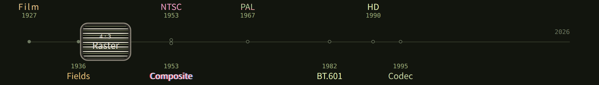

# Video Time Machine

[中文](README_zh.md)

[](https://xinyu2004.github.io/Video-Time-Machine/)

Open the picture, or open https://xinyu2004.github.io/Video-Time-Machine/

Film is 24 frames a second, and each frame is a whole picture. Television has no such beat. Into 60 fields, 24 is first taken as 23.976 and spread 3:2. Into 50 fields, the reel is usually pulled up to 25 and then split 2:2, both fields from the same frame, and the sound rises by about 4%.

Electronic scanning went on the air in 1936, and the field rate locked to the local supply frequency. The current reverses 50 or 60 times a second, and the fields follow: 50 fields and 25 pictures, or 60 fields and 30. Today’s 25 and 30 frames are those two numbers left behind. A lamp’s brightness follows instantaneous power, and power is the square of the voltage, so the lamp flickers at twice that frequency, 100 Hz or 120 Hz.

How many lines fit in one field is limited by the channel. With the picture in about 4.2 MHz and the sound 4.5 MHz above it, 525 lines fit. 525 = 3×5×5×7, so the divider chain is a few small integers. A wider channel uses 625 lines, and the line rate is exactly 15625 Hz, 625 = 5⁴. 2:1 interlace needs an odd total, so the two fields land half a line apart.

Color is added onto the luminance, and the subcarrier has to sit in a gap of that spectrum. NTSC takes the subcarrier as 455/2 of the line rate and the sound as 286 times the line rate, so the frame rate becomes 30000/1001, about 29.97. Hue is the subcarrier’s angle against the burst. A longer path turns the color by that angle.

PAL uses 625 lines and 50 fields, and it reverses (R−Y) on alternate lines. The decoder flips the next line back and adds the two: the hue returns to the angle that was sent, and the amplitude becomes cos φ times the original. The subcarrier also carries an extra 1/625 of the line rate, so it drifts slowly against the line structure and the dots are lighter. In a narrow channel the European 4.43 MHz subcarrier would hit the sound at 4.5 MHz, so PAL-M on 525 lines and PAL-N on narrow 625 lines compute a different subcarrier.

Composite adds luminance and chrominance on one wire. Dot crawl and rainbows are that carrier left in the samples. Rec. 601 samples component instead: one 13.5 MHz luma clock everywhere, 720 active luma samples on a line, and the luma coefficients are still the row solved in 1953. BT.709 solves that row again from the HD primaries and D65, and BT.2020 solves it once more. The curve changes only at BT.2100, to PQ or HLG. Compression comes after the samples. A later codec is written into files, and the earlier one stays on the air and on discs.

## On the site

- **Timeline:** follow the years, and see how video became what it is
- **From the look:** you see a look, and ask why
- **Phenomena:** you meet a problem, and take the cause apart
- **Glossary:** a name you don't know, and what it points to

## On your machine

Node is enough to read the site. From the repo root:

```bash
npm install
npm run dev
```

The terminal prints the address.

- `content/timeline/{zh,en}/` chapters
- `content/phenomena/<id>/{zh.mdx,en.mdx,meta.yaml}` entries
- `content/recipes/*.yaml` the commands shown on the site
- `content/decide/tree.yaml` From the look
- `content/glossary/{zh,en}.mdx`
- `apps/web/src/lab/` the figures

`tools/emit-*.mjs` rewrites the entries, the commands, and the glossary. Running one again overwrites hand edits.

## Left out

A 60 Hz panel cannot stand in for a 50 Hz lamp or an interlaced CRT. The pages say so. QTGMC and VapourSynth are named and not brought in. BT.2100 PQ/HLG tone mapping is not here: BT.2020 widens the primaries and keeps an SDR curve; HDR changes the curve.
