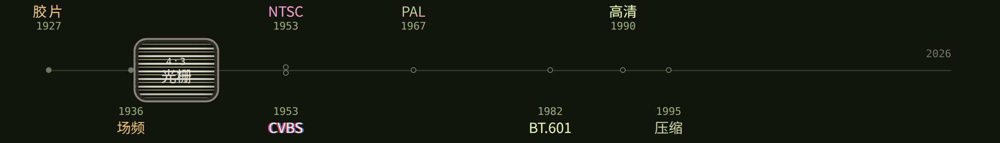

# 视频演变图鉴

[English](README.md)

[](https://xinyu2004.github.io/Video-Time-Machine/)

点上面这张图，或打开 https://xinyu2004.github.io/Video-Time-Machine/

打开是英文。中文在同一地址后面加上 `/zh`。

画面为什么长这样：市电、行数、NTSC 与 PAL，然后是 CCIR 601、BT.709、BT.2020。每一条写清原因，以及这个样子能不能消掉。

## 站上有什么

- **时间线。** 主页那张图，顺着年份看。
- **由象及因。** 看见一个样子，问到原因。
- **现象。** 知道是哪一件之后，条目在这里。
- **术语。** 词。

## 在本机改

看站点只要 Node。在仓库根目录：

```bash
npm install
npm run dev
```

终端会打出地址。

- `content/timeline/{zh,en}/` 各章
- `content/phenomena/<id>/{zh.mdx,en.mdx,meta.yaml}` 条目
- `content/recipes/*.yaml` 站点上给出的命令
- `content/decide/tree.yaml` 由象及因
- `content/glossary/{zh,en}.mdx`
- `apps/web/src/lab/` 图

`tools/emit-*.mjs` 会重写条目、命令和术语。再跑一次会盖掉手改的内容。

## 这里不做的

60 Hz 的屏幕代替不了 50 Hz 的灯，也代替不了隔行显像管。页面上写了这句话。QTGMC 和 VapourSynth 只点了名，没有搬进来。BT.2100 的 PQ/HLG 色调映射不在这里：BT.2020 加宽的是三基色，曲线仍是 SDR；HDR 换的是曲线。
